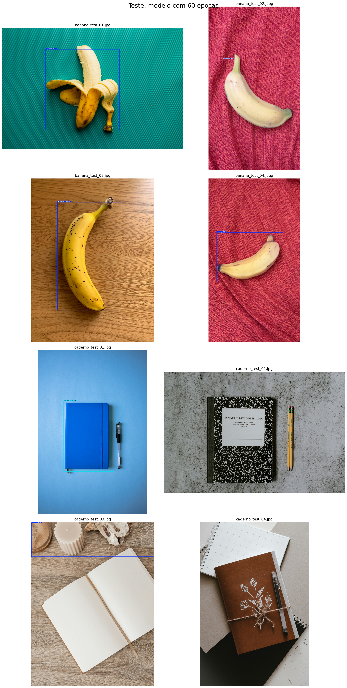
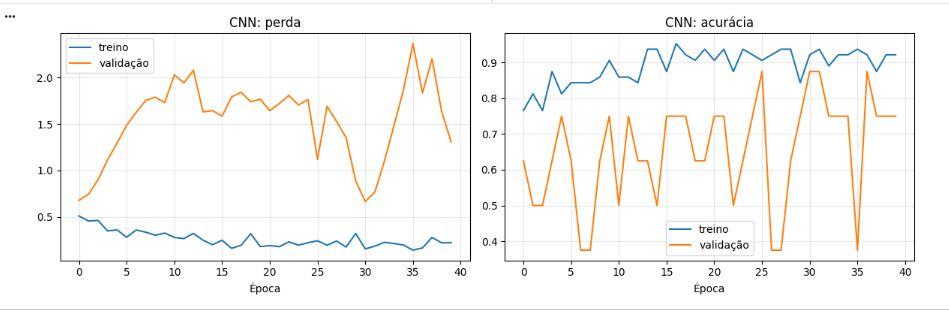
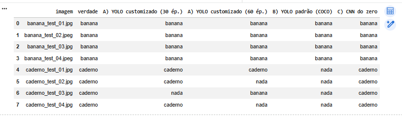
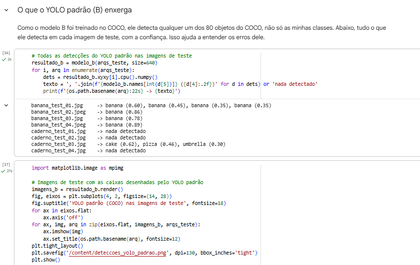
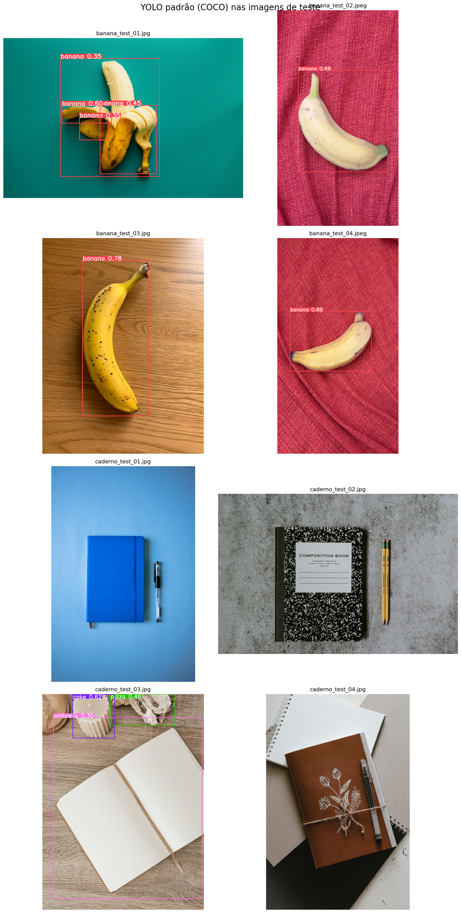

FIAP - Faculdade de Informática e Administração Paulista

# 🌱 FarmTech Solutions - Fase 6: Visão Computacional com YOLOv5

## 👨‍🎓 Integrantes
Natalia de Lima Faro - RM 568610

## 📌 Status do Projeto

| Entrega | Status |
|---|---|
| Entrega 1 — Sistema de visão computacional com YOLO | ✅ Concluída |
| Entrega 2 — Comparação: YOLO customizado x YOLO padrão x CNN do zero | ✅ Concluída |

## 👩‍🏫 Professores
André Godoi

---

## Descrição do Projeto
A FarmTech Solutions está expandindo seus serviços de Inteligência Artificial para além do agronegócio, atendendo clientes em áreas como saúde animal, segurança patrimonial, controle de acessos e análise de documentos, e agora também em **visão computacional**.

Este projeto simula uma visita a um cliente que quer entender, na prática, como funciona um sistema de visão computacional. Para isso, foi construído um detector de objetos com o **YOLOv5**, treinado com um dataset próprio, que demonstra o potencial e a acurácia da técnica ao identificar **bananas** e **cadernos** em imagens.

---

## Entrega 1 — Detecção de Bananas e Cadernos com YOLOv5

## Notebook
O passo a passo completo (código comentado, gráficos, resultados e conclusões) está em:
👉 [Visualizar notebook no repositório](NataliaFaro_RM568610_pbl_fase6.ipynb)

---

## Objetivo
Criar um sistema de visão computacional com YOLO capaz de distinguir dois objetos bem diferentes entre si, e comparar o efeito do **número de épocas de treino** (30 e 60) sobre a acurácia, o erro e o desempenho do modelo.

---

## Dataset
O dataset foi montado com **80 imagens**, combinando fotos tiradas por mim e fotos do Unsplash (créditos em [Creditos.md](FarmTech_YOLO/Creditos.md)).

| Classe | Índice | Treino | Validação | Teste | Total |
|---|---|---|---|---|---|
| `banana` | 0 | 32 | 4 | 4 | 40 |
| `caderno` | 1 | 32 | 4 | 4 | 40 |
| **Total** | | **64** | **8** | **8** | **80** |

**Variedade das imagens:**

- **Bananas:** verdes, maduras, descascadas, isoladas, em pencas e em cachos, sobre fundos e iluminações diferentes;
- **Cadernos:** fechados, abertos, de espiral, com e sem elástico, de várias cores e tamanhos, às vezes mais de um na mesma foto.

**Cuidados na divisão:** fotos muito parecidas (mesma série, mesmo fundo) foram mantidas no mesmo conjunto, para o teste não ficar artificialmente fácil. Validação e teste usam fotos bem distintas das de treino.

> O dataset deste repositório é uma **versão reduzida** (maior lado de 1280 px) das imagens originais, para respeitar os limites do GitHub. O treino foi feito com as imagens originais, guardadas no Google Drive.

---

## Rotulação

As imagens foram rotuladas manualmente no [Make Sense AI](https://www.makesense.ai) e exportadas em formato YOLO (um `.txt` por imagem, com a classe e a posição da caixa).

Critérios adotados, para manter a consistência:

- uma caixa para cada caderno visível;
- pencas e cachos grandes: uma caixa só, na penca inteira;
- banana descascada conta como `banana`.

Todas as imagens do dataset foram verificadas: cada imagem possui o seu arquivo de rótulo (64/64 no treino, 8/8 na validação e 8/8 no teste).

---

## Modelo e Treinamento

- **Modelo:** YOLOv5s (Ultralytics), com pesos pré-treinados no COCO (*transfer learning*);
- **Parâmetros fixos:** imagem de 640 px, batch de 16;
- **Simulações:** dois treinos idênticos, mudando só o número de épocas (**30** e **60**);
- **Ambiente:** Google Colab com GPU Tesla T4.

---

## Resultados

| Épocas | Etapa | Precisão | Recall | mAP@0.5 | mAP@0.5:0.95 | Tempo de treino |
|---|---|---|---|---|---|---|
| 30 | validação | 1,000 | 0,869 | 0,995 | 0,661 | 2,4 min |
| 30 | teste | 0,896 | 0,998 | 0,945 | 0,421 | 2,4 min |
| 60 | validação | 0,949 | 1,000 | 0,995 | 0,703 | 3,1 min |
| 60 | teste | 0,780 | 0,875 | 0,829 | 0,486 | 3,1 min |

### Curvas de treino

Evolução do erro (caixa e classe) e das métricas de validação ao longo das épocas, nos dois treinos:


### Detecções nas imagens de teste

**Modelo com 30 épocas**


**Modelo com 60 épocas**



---

## Análise dos Resultados

- **Validação:** os dois modelos chegaram a mAP@0.5 de 0,995. O de 60 épocas teve recall e mAP@0.5:0.95 maiores, e o de 30 épocas teve precisão maior. A validação tem só 8 imagens e foi usada para escolher o melhor peso, então esses números são otimistas.
- **Teste:** o desempenho caiu nos dois modelos, e o de **30 épocas foi melhor** na maioria das métricas (mAP@0.5 de 0,945 contra 0,829). O de 60 épocas só foi melhor no mAP@0.5:0.95, puxado por caixas mais justas nas bananas.
- **Por classe:** as **bananas** foram detectadas pelos dois modelos (4 de 4 no teste). Os **cadernos** foram o ponto fraco, principalmente os de aparência menos comum, como um caderno aberto sobre madeira.
- **Erro (loss):** o erro de validação caiu nos dois treinos e não voltou a subir no final, sem sinais claros de overfitting. Mesmo assim, o erro menor das 60 épocas não se traduziu em melhor resultado no teste.
- **Desempenho:** 60 épocas levaram cerca de 0,7 min a mais (29%) e **não trouxeram ganho claro**, o que indica que o limite está na quantidade e na variedade dos dados.

---

## Pontos Fortes

- Classes visualmente muito distintas, o que facilita o aprendizado;
- *Transfer learning* com pesos do COCO (dataset público com cerca de 80 categorias de objetos comuns) permite bons resultados com poucas imagens;
- Dataset com variedade de fundos, iluminação e estados dos objetos.

## Limitações

- **Dataset pequeno** (64 imagens de treino): com 8 imagens de validação e 8 de teste, um único erro muda muito as métricas;
- **Fotos próprias concentradas no treino:** validação e teste usam só imagens do Unsplash, mais "limpas" que fotos do dia a dia;
- **Séries de fotos parecidas** (mesmo cenário e objeto) podem inflar o desempenho no treino;
- Apenas duas classes, sem imagens com os dois objetos juntos e sem objetos parecidos (como livros ou outras frutas) para medir falsos positivos.

## Recomendação ao Cliente

O sistema demonstra potencial: com apenas 64 imagens de treino, o YOLOv5 aprendeu a localizar bananas com confiabilidade e obteve mAP@0.5 de 0,945 no teste com 30 épocas. Os cadernos, porém, foram o ponto fraco, com falhas em objetos de aparência menos comum, e treinar por mais tempo (60 épocas) não melhorou o resultado.

Para uso real, recomenda-se ampliar o banco de imagens (centenas por classe), incluir mais cenários, ângulos e iluminação, adicionar objetos parecidos para medir falsos positivos, testar modelos maiores (como o YOLOv5m) e validar com imagens do ambiente real do cliente.

---

## Como Executar o Projeto

1. Abrir o notebook no Google Colab: [Abrir no Colab]([LINK DO COLAB]);
2. Ativar a GPU em *Ambiente de execução → Alterar tipo de ambiente de execução → GPU (T4)*;
3. Colocar a pasta do dataset no Google Drive em `Meu Drive/FarmTech_YOLO`, com as subpastas `images` e `labels` (cada uma com `train`, `val` e `test`). Se usar outro caminho, ajustar a variável `DRIVE_DATASET` no notebook;
4. Executar todas as células. Os dois treinos levam poucos minutos na GPU T4;
5. Conferir as métricas, os gráficos e as detecções nas imagens de teste.

**Tecnologias:** Python, PyTorch, [YOLOv5 (Ultralytics)](https://github.com/ultralytics/yolov5), Google Colab, Make Sense AI, pandas e matplotlib.

---

## 🎥 Vídeo da Entrega 1
https://youtu.be/EJR0Yj7dCCc

---

## Evidências de Execução

Prints das etapas de verificação, treino, validação e teste, disponíveis em [`FarmTech_YOLO/resultados/`](FarmTech_YOLO/resultados/):

1. [Verificação do dataset (64/8/8 imagens e rótulos)](FarmTech_YOLO/resultados/verificacao_dataset.png)
2. [Métricas de validação e teste do `val.py`](FarmTech_YOLO/resultados/metricas_val_test.png)
3. [Tabela comparativa: 30 x 60 épocas](FarmTech_YOLO/resultados/tabela_comparativa.png)
4. [Curvas de erro e de métricas dos dois treinos](FarmTech_YOLO/resultados/curvas_treino.png)
5. [Detecções no teste, modelo de 30 épocas](FarmTech_YOLO/resultados/deteccoes_teste_30ep.png)
6. [Detecções no teste, modelo de 60 épocas](FarmTech_YOLO/resultados/deteccoes_teste_60ep.png)

---

## Entrega 2 — YOLO customizado x YOLO padrão x CNN do zero

## Notebook
O passo a passo completo (código comentado, gráficos, tabelas e análise crítica) está em:
👉 [Visualizar notebook no repositório](NataliaFaro_RM568610_pbl_fase6_entrega2.ipynb)

---

## Objetivo
Comparar o YOLO customizado da Entrega 1 com outras duas abordagens, usando **a mesma base de 80 imagens e a mesma divisão** (64 treino / 8 validação / 8 teste):

| | Abordagem | Descrição | Treino |
|---|---|---|---|
| **A** | YOLO customizado | YOLOv5s ajustado com as minhas imagens (Entrega 1), com 30 e 60 épocas | Entrega 1 |
| **B** | YOLO padrão | YOLOv5s original, pré-treinado no COCO, **sem nenhum ajuste** | nenhum |
| **C** | CNN do zero | Rede convolucional simples em PyTorch, treinada só com as minhas 64 imagens, que classifica a imagem inteira | feito na Entrega 2 |

---

## Como a comparação foi feita
O YOLO **desenha caixas** e a CNN **só classifica a imagem inteira**. O ponto em comum é a **classificação da imagem**, então a métrica principal é a **acurácia por imagem**:

- **CNN:** a classe prevista para a imagem;
- **YOLO:** a classe da detecção com maior confiança na imagem (se nada for detectado, conta como erro);
- **YOLO padrão (B):** o COCO tem `banana`, mas **não tem `caderno`**. Considerei `book` (livro) como o equivalente mais próximo e ignorei as demais classes do COCO.

Os rótulos da CNN vêm do nome do arquivo (`banana_...` ou `caderno_...`), então não foi preciso rotular de novo. Todos os modelos foram avaliados no mesmo ambiente (GPU T4), com os mesmos limiares de confiança (0,25) do YOLO.

> **Cuidado com o tamanho do teste:** são só 8 imagens, então cada acerto ou erro muda a acurácia em 12,5 pontos percentuais.

---

## A CNN treinada do zero

- **Entrada:** imagens de 128 x 128 pixels, com *data augmentation* no treino (recorte aleatório, espelhamento, rotação e variação de cor);
- **Arquitetura:** 4 blocos convolucionais (convolução, normalização, ReLU e *max pooling*), média global, *dropout* e camada final com 2 saídas;
- **Treino:** 40 épocas com Adam, e a validação escolhendo a melhor época (o teste nunca foi usado no treino);
- **Resultado do treino:** melhor época **31**, tempo de treino de **7 segundos** (0,1 min) na GPU T4.



---

## Resultados

| Abordagem | Acurácia validação | Acurácia teste | Sem detecção (teste) | mAP@0.5 teste | Tempo de treino | Inferência (ms/img) | Tamanho (MB) |
|---|---|---|---|---|---|---|---|
| A) YOLO customizado (30 ép.) | 0,875 | 0,875 | 1 | 0,945 | 2,4 min | 407,7 | 14,4 |
| A) YOLO customizado (60 ép.) | 0,750 | 0,625 | 2 | 0,829 | 3,1 min | 413,8 | 14,4 |
| B) YOLO padrão (COCO) | 0,750 | 0,500 | 4 | - | nenhum | 398,1 | 14,8 |
| C) CNN do zero | 0,875 | 1,000 | - | - | 7 s (0,1 min) | 464,9 | 0,4 |

> A validação é otimista para A e C, porque foi usada para escolher o melhor modelo. O **teste** é a medida mais honesta. O mAP não existe para a CNN (ela não localiza objetos) e não é comparável para o YOLO padrão (as classes do COCO são outras).

### Imagem por imagem no teste



### O que o YOLO padrão detecta

Como foi treinado no COCO, ele reconhece qualquer um dos 80 objetos do COCO, não só as minhas classes:





---

## Análise Crítica

**Facilidade de uso e integração**

- **B) YOLO padrão:** é o mais simples: carregar os pesos prontos e rodar, sem dados, rótulos ou treino. Mas só reconhece as 80 classes do COCO;
- **A) YOLO customizado:** exigiu montar o dataset, **rotular com caixas** (a etapa mais trabalhosa), treinar e conferir os arquivos. Depois de pronto, integra com facilidade (por exemplo, com o ESP32-CAM do capítulo 3) e informa **onde** está o objeto, não só **qual** é;
- **C) CNN do zero:** exigiu escrever a arquitetura, o laço de treino e o *data augmentation*, mas **não precisa de caixas**, só de um rótulo por imagem, muito mais barato de produzir. Em compensação, só diz a classe da imagem inteira, sem localizar nem contar objetos.

**Precisão**

- **Teste:** a CNN acertou **8 de 8** imagens (1,000), o YOLO customizado de 30 épocas acertou **7 de 8** (0,875), o de 60 épocas **5 de 8** (0,625) e o YOLO padrão **4 de 8** (0,500);
- **Bananas:** as quatro abordagens acertaram as 4 bananas de teste. A diferença está toda nos **cadernos**;
- **YOLO padrão (B):** **não reconheceu nenhum dos 4 cadernos**. Mesmo tratando `book` como `caderno`, essa classe não foi detectada em nenhuma imagem; na `caderno_test_03` ele viu `cake`, `pizza` e `umbrella`. Isso mostra o limite de um modelo com classes fixas: o que não está no COCO não é reconhecido. Ele também fragmentou a banana descascada em 4 caixas, embora a classe da imagem tenha ficado correta;
- **YOLO customizado:** o de 30 épocas errou só a `caderno_test_03` (caderno aberto sobre madeira, não detectado). O de 60 épocas errou 3 cadernos: não detectou 2 e classificou a `caderno_test_03` como `banana`. Isso confirma a Entrega 1: treinar por mais tempo não melhorou o modelo;
- **CNN:** acertou os 4 cadernos, inclusive o caderno aberto que o YOLO não encontrou;
- **Cuidado:** com 8 imagens de teste, a diferença entre a CNN (8/8) e o YOLO de 30 épocas (7/8) é de **uma única imagem**, então não dá para afirmar que a CNN é melhor. Além disso, a CNN **sempre devolve uma das duas classes** (nunca diz "nada"), enquanto o YOLO precisa detectar o objeto com confiança mínima de 0,25 **e** dizer onde ele está, uma tarefa mais difícil;
- **Overfitting na CNN:** a acurácia de treino ficou perto de 0,92, mas a de validação oscilou entre 0,38 e 0,88, e a perda de validação ficou bem acima da de treino. É sinal de overfitting e instabilidade, agravado pela validação de só 8 imagens.

**Tempo de treinamento e customização**

- **B:** nenhum;
- **A:** cerca de 2,4 min (30 épocas) e 3,1 min (60 épocas) na T4, mais o tempo de rotular 72 imagens com caixas;
- **C:** **7 segundos** (40 épocas, melhor época: 31), cerca de 20 a 27 vezes mais rápido que o YOLO e sem o trabalho de rotular caixas.

**Tempo de inferência**

- Os tempos ficaram todos entre **398 e 465 ms por imagem**: YOLO padrão 398,1; YOLO customizado 407,7 (30 ép.) e 413,8 (60 ép.); CNN 464,9;
- **Atenção ao que esse número mede:** ele vai do arquivo até a classe prevista e inclui a **leitura e o redimensionamento de fotos grandes**, que pesam em todos. Por isso as diferenças são pequenas e **não refletem a velocidade da rede em si**. A CNN aparece como a mais lenta porque o meu pré-processamento (correção de rotação e redução da foto em tamanho original, na CPU) é mais pesado que o do YOLO, e não porque a rede seja lenta: ela tem só 0,4 MB;
- **Tamanho:** a CNN (0,4 MB) é cerca de **36 vezes menor** que o YOLOv5s (14,4 a 14,8 MB), o que importa em dispositivos limitados, como o ESP32-CAM e o Jetson Nano citados no capítulo 3.

---

## Qual abordagem usar

- **YOLO padrão (B):** quando os objetos de interesse já estão nas classes do COCO (pessoas, carros, bananas) e não há tempo ou dados para treinar;
- **YOLO customizado (A):** quando é preciso **reconhecer e localizar** objetos específicos do cliente, e vale investir em rotular;
- **CNN do zero (C):** quando basta **classificar a imagem inteira**, os rótulos são baratos e o modelo precisa ser leve. Com poucas imagens, tende a precisar de bem mais dados que o YOLO, que parte de pesos pré-treinados.

**Recomendação para o cliente:** se o cliente só precisa saber **qual objeto aparece na foto**, vale começar pela CNN, pela simplicidade, pelo tamanho e pelo custo, ampliando antes a base de imagens para confirmar a estabilidade. Se precisa **localizar** os objetos (contar, recortar, acionar algo na posição), a melhor escolha foi o **YOLO customizado de 30 épocas** (7 de 8 e mAP@0.5 de 0,945). O **YOLO padrão** só se justifica para classes que já existem no COCO, e **mais épocas** não ajudaram nenhum dos modelos.

## Limitações da Entrega 2

- Base muito pequena (64 treino, 8 validação e 8 teste), e o teste só tem fotos do Unsplash;
- O YOLO padrão foi adaptado (`book` tratado como `caderno`), então o resultado dele depende dessa escolha;
- A validação é otimista para A e C;
- O tempo de inferência inclui a leitura de fotos grandes e não mede a rede isoladamente;
- A comparação por imagem favorece a CNN, que não tem a opção de "não detectar".

---

## Como Executar (Entrega 2)

1. Abrir o notebook no Google Colab
2. Ativar a GPU em *Ambiente de execução → Alterar tipo de ambiente de execução → GPU (T4)*;
3. Ter a pasta `FarmTech_YOLO` no Google Drive (como na Entrega 1) e os pesos `best.pt` da Entrega 1 em `FarmTech_YOLO/resultados_runs/train/`. Se usar outro caminho, ajustar `DRIVE_DATASET`, `PESOS_30` e `PESOS_60` no notebook;
4. Executar todas as células.

**Tecnologias:** Python, PyTorch, torchvision, [YOLOv5 (Ultralytics)](https://github.com/ultralytics/yolov5), Google Colab, pandas e matplotlib.

---

## Evidências de Execução (Entrega 2)

Prints disponíveis em [`FarmTech_YOLO/resultados_entrega2/`](FarmTech_YOLO/resultados_entrega2/):

1. [Treino da CNN (perda, acurácia e tempo)](FarmTech_YOLO/resultados_entrega2/treino_cnn.png)
2. [Curvas da CNN](FarmTech_YOLO/resultados_entrega2/curvas_cnn.png)
3. [Acurácia por imagem no teste](FarmTech_YOLO/resultados_entrega2/tabela_teste_por_imagem.png)
4. [O que o YOLO padrão detecta (texto)](FarmTech_YOLO/resultados_entrega2/deteccoes_yolo_padrao_texto.png)
5. [Detecções do YOLO padrão nas imagens de teste](FarmTech_YOLO/resultados_entrega2/deteccoes_yolo_padrao.png)
6. [Tempo de inferência das abordagens](FarmTech_YOLO/resultados_entrega2/tempo_inferencia.png)
7. [Tabela comparativa final](FarmTech_YOLO/resultados_entrega2/tabela_comparativa_entrega2.png)

---

## 📁 Estrutura do Repositório

```
├── README.md
├── NataliaFaro_RM568610_pbl_fase6.ipynb             # Entrega 1
├── NataliaFaro_RM568610_pbl_fase6_entrega2.ipynb    # Entrega 2
└── FarmTech_YOLO/
    ├── Creditos.md
    ├── images/   (train, val, test)
    ├── labels/   (train, val, test)
    ├── resultados/            # prints da Entrega 1
    └── resultados_entrega2/   # prints da Entrega 2
```

- **`NataliaFaro_RM568610_pbl_fase6.ipynb`:** notebook da Entrega 1, executado, com o passo a passo, o código comentado, os gráficos e as conclusões;
- **`NataliaFaro_RM568610_pbl_fase6_entrega2.ipynb`:** notebook da Entrega 2, com o YOLO padrão, a CNN do zero e a comparação das três abordagens;
- **`FarmTech_YOLO/images` e `FarmTech_YOLO/labels`:** imagens (versão reduzida) e rótulos no formato YOLO, separados em treino, validação e teste. A estrutura é a mesma usada no Google Drive pelo notebook;
- **`FarmTech_YOLO/resultados`:** prints da Entrega 1 (métricas, gráficos e detecções nas imagens de teste);
- **`FarmTech_YOLO/resultados_entrega2`:** prints da Entrega 2 (CNN, YOLO padrão e comparação);
- **`FarmTech_YOLO/Creditos.md`:** fotógrafos das imagens do Unsplash.

---

## Créditos das Imagens

Parte das imagens vem do [Unsplash](https://unsplash.com), usadas sob a [Licença Unsplash](https://unsplash.com/license). A lista completa está em [Creditos.md](FarmTech_YOLO/Creditos.md).
