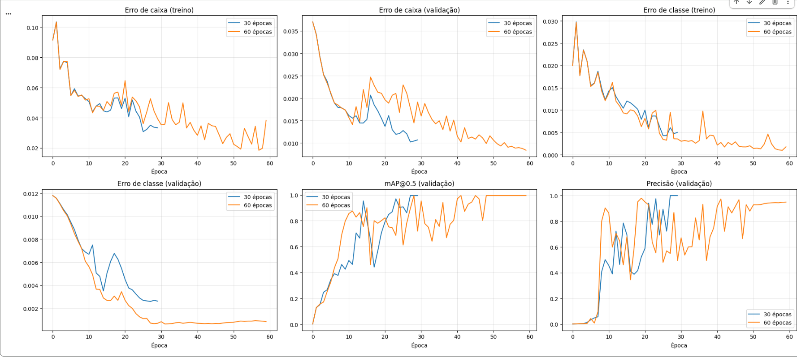

FIAP - Faculdade de Informática e Administração Paulista

# FarmTech Solutions - Fase 6: Visão Computacional com YOLOv5

## 👨‍🎓 Integrantes
Natalia de Lima Faro - RM 568610

## 📌 Status do Projeto

| Entrega | Status |
|---|---|
| Entrega 1 — Sistema de visão computacional com YOLO | ✅ Concluída |
| Entrega 2 | ⏳ Em desenvolvimento |

## 👩‍🏫 Professores
André Godoi

---

## 📜 Descrição do Projeto
A FarmTech Solutions está expandindo seus serviços de Inteligência Artificial para além do agronegócio, atendendo clientes em áreas como saúde animal, segurança patrimonial, controle de acessos e análise de documentos, e agora também em **visão computacional**.
Este projeto simula uma visita a um cliente que quer entender, na prática, como funciona um sistema de visão computacional. Para isso, foi construído um detector de objetos com o **YOLOv5**, treinado com um dataset próprio, que demonstra o potencial e a acurácia da técnica ao identificar **bananas** e **cadernos** em imagens.

---

# 📌 Entrega 1 — Detecção de Bananas e Cadernos com YOLOv5

## 📓 Notebook
O passo a passo completo (código comentado, gráficos, resultados e conclusões) está no notebook:

[Visualizar notebook no repositório](NataliaFaro_rm568610_pbl_fase6.ipynb)

---

## 🎯 Objetivo

Criar um sistema de visão computacional com YOLO capaz de distinguir dois objetos bem diferentes entre si, e comparar o efeito do **número de épocas de treino** (30 e 60) sobre a acurácia, o erro e o desempenho do modelo.

---

## 🗂️ Dataset

O dataset foi montado com **80 imagens**, combinando fotos tiradas por mim e fotos do Unsplash (créditos em [CREDITOS.md](CREDITOS.md)).

| Classe | Índice | Treino | Validação | Teste | Total |
|---|---|---|---|---|---|
| `banana` | 0 | 32 | 4 | 4 | 40 |
| `caderno` | 1 | 32 | 4 | 4 | 40 |
| **Total** | | **64** | **8** | **8** | **80** |

**Variedade das imagens:**

- **Bananas:** verdes, maduras, descascadas, isoladas, em pencas e em cachos, sobre fundos e iluminações diferentes;
- **Cadernos:** fechados, abertos, de espiral, com e sem elástico, de várias cores e tamanhos, às vezes mais de um na mesma foto.

**Cuidados na divisão:** fotos muito parecidas (mesma série, mesmo fundo) foram mantidas no mesmo conjunto, para o teste não ficar artificialmente fácil. Validação e teste usam fotos bem distintas das de treino.

> O dataset deste repositório é uma **versão reduzida** (maior lado de 1280 px) das imagens originais, para respeitar os limites do GitHub. O treino foi feito com as imagens originais, guardadas no Google Drive.

---

## 🏷️ Rotulação

As imagens foram rotuladas manualmente no [Make Sense AI](https://www.makesense.ai) e exportadas em formato YOLO (um `.txt` por imagem, com a classe e a posição da caixa).

Critérios adotados, para manter a consistência:

- uma caixa para cada caderno visível;
- pencas e cachos grandes: uma caixa só, na penca inteira;
- banana descascada conta como `banana`.

Todas as imagens do dataset foram verificadas: cada imagem possui o seu arquivo de rótulo (64/64 no treino, 8/8 na validação e 8/8 no teste).

---

## 🤖 Modelo e Treinamento

- **Modelo:** YOLOv5s (Ultralytics), com pesos pré-treinados no COCO (*transfer learning*);
- **Parâmetros fixos:** imagem de 640 px, batch de 16;
- **Simulações:** dois treinos idênticos, mudando só o número de épocas (**30** e **60**);
- **Ambiente:** Google Colab com GPU Tesla T4.

---

## 📈 Resultados

| Épocas | Etapa | Precisão | Recall | mAP@0.5 | mAP@0.5:0.95 | Tempo de treino |
|---|---|---|---|---|---|---|
| 30 | validação | 1,000 | 0,869 | 0,995 | 0,661 | 2,4 min |
| 30 | teste | 0,896 | 0,998 | 0,945 | 0,421 | 2,4 min |
| 60 | validação | 0,949 | 1,000 | 0,995 | 0,703 | 3,1 min |
| 60 | teste | 0,780 | 0,875 | 0,829 | 0,486 | 3,1 min |

### Curvas de treino
Evolução do erro (caixa e classe) e das métricas de validação ao longo das épocas, nos dois treinos:



### Detecções nas imagens de teste

**Modelo com 30 épocas**


**Modelo com 60 épocas**


---

## 🔍 Análise dos Resultados

- **Validação:** os dois modelos chegaram a mAP@0.5 de 0,995. O de 60 épocas teve recall e mAP@0.5:0.95 maiores, e o de 30 épocas teve precisão maior. A validação tem só 8 imagens e foi usada para escolher o melhor peso, então esses números são otimistas.
- **Teste:** o desempenho caiu nos dois modelos, e o de **30 épocas foi melhor** na maioria das métricas (mAP@0.5 de 0,945 contra 0,829). O de 60 épocas só foi melhor no mAP@0.5:0.95, puxado por caixas mais justas nas bananas.
- **Por classe:** as **bananas** foram detectadas pelos dois modelos (4 de 4 no teste). Os **cadernos** foram o ponto fraco, principalmente os de aparência menos comum, como um caderno aberto sobre madeira.
- **Erro (loss):** o erro de validação caiu nos dois treinos e não voltou a subir no final, sem sinais claros de overfitting. Mesmo assim, o erro menor das 60 épocas não se traduziu em melhor resultado no teste.
- **Desempenho:** 60 épocas levaram cerca de 0,7 min a mais (29%) e **não trouxeram ganho claro**, o que indica que o limite está na quantidade e na variedade dos dados.

---

## ✅ Pontos Fortes

- Classes visualmente muito distintas, o que facilita o aprendizado;
- *Transfer learning* com pesos do COCO (dataset público com cerca de 80 categorias de objetos comuns) permite bons resultados com poucas imagens;
- Dataset com variedade de fundos, iluminação e estados dos objetos.

## ⚠️ Limitações

- **Dataset pequeno** (64 imagens de treino): com 8 imagens de validação e 8 de teste, um único erro muda muito as métricas;
- **Fotos próprias concentradas no treino:** validação e teste usam só imagens do Unsplash, mais "limpas" que fotos do dia a dia;
- **Séries de fotos parecidas** (mesmo cenário e objeto) podem inflar o desempenho no treino;
- Apenas duas classes, sem imagens com os dois objetos juntos e sem objetos parecidos (como livros ou outras frutas) para medir falsos positivos.

## 💼 Recomendação ao Cliente

O sistema demonstra potencial: com apenas 64 imagens de treino, o YOLOv5 aprendeu a localizar bananas com confiabilidade e obteve mAP@0.5 de 0,945 no teste com 30 épocas. Os cadernos, porém, foram o ponto fraco, com falhas em objetos de aparência menos comum, e treinar por mais tempo (60 épocas) não melhorou o resultado.

Para uso real, recomenda-se ampliar o banco de imagens (centenas por classe), incluir mais cenários, ângulos e iluminação, adicionar objetos parecidos para medir falsos positivos, testar modelos maiores (como o YOLOv5m) e validar com imagens do ambiente real do cliente.

---

## ⚙️ Como Executar o Projeto

1. Abrir o notebook no Google Colab
2. Ativar a GPU em *Ambiente de execução → Alterar tipo de ambiente de execução → GPU (T4)*;
3. Colocar a pasta do dataset no Google Drive em `Meu Drive/FarmTech_YOLO`, com as subpastas `images` e `labels` (cada uma com `train`, `val` e `test`). Se usar outro caminho, ajustar a variável `DRIVE_DATASET` no notebook;
4. Executar todas as células. Os dois treinos levam poucos minutos na GPU T4;
5. Conferir as métricas, os gráficos e as detecções nas imagens de teste.

**Tecnologias:** Python, PyTorch, [YOLOv5 (Ultralytics)](https://github.com/ultralytics/yolov5), Google Colab, Make Sense AI, pandas e matplotlib.

---

## 🎥 Vídeo da Entrega 1

[LINK DO YOUTUBE NÃO LISTADO]

---

## 📸 Evidências de Execução

Prints das etapas de verificação, treino, validação e teste, disponíveis em [`resultados/`](resultados/):

1. [Verificação do dataset (64/8/8 imagens e rótulos)](resultados/verificacao_dataset.png)
2. [Métricas de validação e teste do `val.py`](resultados/metricas_val_test.png)
3. [Tabela comparativa: 30 x 60 épocas](resultados/tabela_comparativa.png)
4. [Curvas de erro e de métricas dos dois treinos](resultados/curvas_treino.png)
5. [Detecções no teste, modelo de 30 épocas](resultados/deteccoes_teste_30ep.png)
6. [Detecções no teste, modelo de 60 épocas](resultados/deteccoes_teste_60ep.png)

---

## 📁 Estrutura do Repositório

```
├── README.md
├── CREDITOS.md
├── NataliaFaro_rm568610_pbl_fase6.ipynb
├── dataset/
│   ├── images/   (train, val, test)
│   └── labels/   (train, val, test)
└── resultados/
```

- **`NataliaFaro_rm568610_pbl_fase6.ipynb`:** notebook executado, com o passo a passo, o código comentado, os gráficos e as conclusões;
- **`dataset/`:** imagens (versão reduzida) e rótulos no formato YOLO, separados em treino, validação e teste;
- **`resultados/`:** prints das métricas, gráficos e detecções nas imagens de teste;
- **`CREDITOS.md`:** fotógrafos das imagens do Unsplash.

---

## 🖼️ Créditos das Imagens
Parte das imagens vem do [Unsplash](https://unsplash.com), usadas sob a [Licença Unsplash](https://unsplash.com/license). A lista completa está em [CREDITOS.md](CREDITOS.md).
